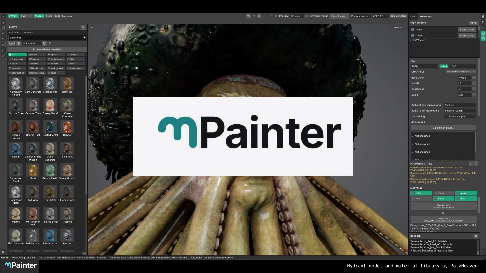

# mPainter

Ready-made Early Access Alpha builds are on [Gumroad](https://mattiaslind.gumroad.com/l/mpainter).

[Watch the launch video](docs/marketing/2026-11-06-mpainter-launch.mp4)

mPainter is a GPL-licensed 3D texture painting application by Mattias Lind. It combines a Qt workspace with Blender rendering in one process.

Built with a lot of AI help. Big thanks to Claude for all the late-night coding sessions.

Paint in 3D and UV views, organize layers and masks, work with texture sets and UDIMs, import textures and Blender materials, and save editable projects as `.blend` files. Material Presets and Mask Generators provide reusable authoring workflows. Imports of user-owned `.spmsk` files are a compatibility feature; unsupported source operations are reported by the importer.

The application starts with an empty material library. [Download free materials from Poly Haven](https://polyhaven.com/textures): its materials are CC0. Unpack downloads, then import or drop the image files into Assets. Nothing is downloaded automatically.

Build and packaging instructions are in [docs/building.md](docs/building.md). Linux x86_64 and macOS arm64 are the platforms mPainter is run and tested on. The macOS viewport uses a Metal port that is not yet merged into this repository: until it lands, the macOS section of `docs/building.md` describes the state before the port and these sources alone do not build a working Mac package. A cross-built Windows x64 0.9.2 package started and passed a basic paint, save and export workflow in a Windows 11 VM with software rendering. It has not been tested on real GPU hardware, and HTTPS material downloads currently fail on Windows; see the [Windows build notes](scripts/cross-windows/README.md#lessons-from-the-verified-092-build).

The supplied splash artwork and Mattias Lind’s m-mark icon establish mPainter's own identity. Source and asset attributions are in [NOTICE.md](NOTICE.md); see [LICENSE](LICENSE) for GPL-3.0.

Not affiliated with or endorsed by Adobe. Substance 3D is a trademark of Adobe Inc.
